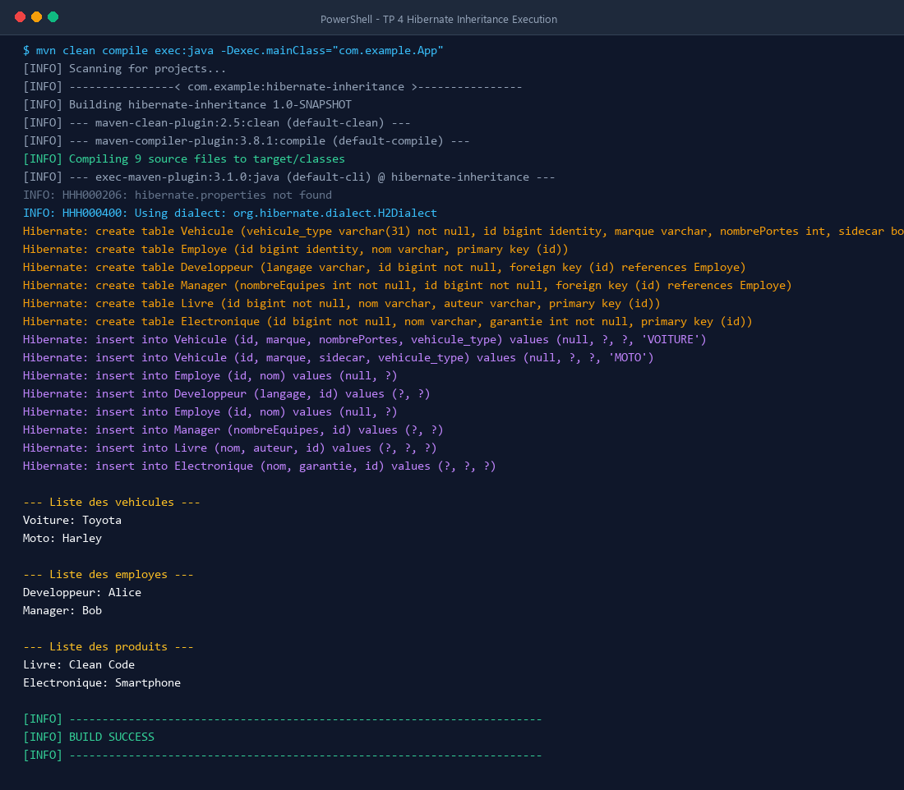
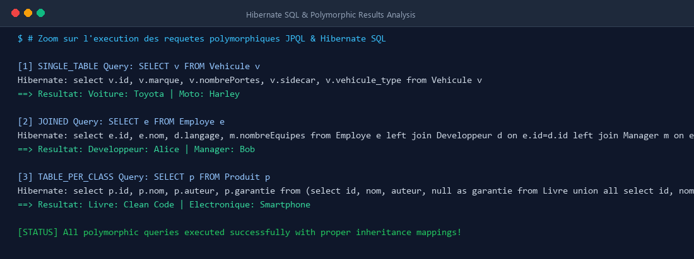

# TP 4 : Héritage avec Hibernate - Stratégies de Mapping

Ce projet met en pratique la gestion de l'héritage objet-relationnel avec **JPA (Java Persistence API)** et son implémentation **Hibernate**, en utilisant une base de données relationnelle embarquée en mémoire **H2**.

---

## 🎯 Objectifs du TP

1. Comprendre et implémenter les **3 stratégies de mapping d'héritage** offertes par JPA :
   - `SINGLE_TABLE` (Une seule table pour toute la hiérarchie)
   - `JOINED` (Une table par classe avec jointures via clés étrangères)
   - `TABLE_PER_CLASS` (Une table par classe concrète avec duplication des colonnes héritées)
2. Configurer un projet Maven complet avec `persistence.xml` sans dépendance vers des frameworks tiers (pur JEE / JPA).
3. Effectuer des opérations d'insertion et des requêtes polymorphiques JPQL pour analyser le comportement et le SQL généré par Hibernate.
4. Comparer les avantages, inconvénients et cas d'usage de chaque stratégie.

---

## 🏗️ Structure du Projet

```text
TP 4 : Héritage avec Hibernate - Stratégies de Mapping/
├── pom.xml
├── README.md
├── screenshots/
│   ├── terminal_execution.png
│   └── polymorphic_queries.png
└── src/
    └── main/
        ├── java/
        │   └── com/
        │       └── example/
        │           ├── App.java
        │           └── model/
        │               ├── singletable/
        │               │   ├── Vehicule.java       (Classe abstraite - SINGLE_TABLE)
        │               │   ├── Voiture.java        (Sous-classe @DiscriminatorValue("VOITURE"))
        │               │   └── Moto.java           (Sous-classe @DiscriminatorValue("MOTO"))
        │               ├── joined/
        │               │   ├── Employe.java        (Classe abstraite - JOINED)
        │               │   ├── Developpeur.java    (Sous-classe concrète)
        │               │   └── Manager.java        (Sous-classe concrète)
        │               └── tableperclass/
        │                   ├── Produit.java        (Classe abstraite - TABLE_PER_CLASS)
        │                   ├── Livre.java          (Sous-classe concrète)
        │                   └── Electronique.java   (Sous-classe concrète)
        └── resources/
            └── META-INF/
                └── persistence.xml
```

---

## ⚙️ Les Trois Stratégies d'Héritage

### 1. Stratégie `SINGLE_TABLE` (Table Unique)
- **Principe** : Toutes les classes de la hiérarchie (`Vehicule`, `Voiture`, `Moto`) sont stockées dans une seule table `Vehicule`.
- **Colonne Discriminante** : Une colonne `vehicule_type` identifie le type concret de chaque enregistrement (`VOITURE` ou `MOTO`).
- **Avantages** : Performances optimales en lecture (aucune jointure nécessaire).
- **Inconvénients** : Les colonnes spécifiques aux sous-classes doivent accepter des valeurs `NULL`.

### 2. Stratégie `JOINED` (Tables Jointes)
- **Principe** : Chaque classe possède sa propre table (`Employe`, `Developpeur`, `Manager`). Les tables des sous-classes partagent la même clé primaire que la table mère via une contrainte de clé étrangère (`FOREIGN KEY`).
- **Avantages** : Modèle relationnel normalisé, aucune colonne nulle superflue.
- **Inconvénients** : Les requêtes polymorphiques nécessitent des jointures (`LEFT OUTER JOIN`), ce qui peut impacter les performances sur des tables volumineuses.

### 3. Stratégie `TABLE_PER_CLASS` (Table par Classe Concrète)
- **Principe** : Chaque classe concrète (`Livre`, `Electronique`) possède sa propre table contenant tous les attributs (y compris ceux hérités de `Produit`). Aucune table n'est créée pour la classe abstraite `Produit`.
- **Avantages** : Tables autonomes, pas de jointures pour requêter une table spécifique.
- **Inconvénients** : Duplication des colonnes communes. Les requêtes polymorphiques utilisent des `UNION`, ce qui est plus coûteux.

---

## 📊 Tableau Comparatif des Stratégies

| Critère | SINGLE_TABLE | JOINED | TABLE_PER_CLASS |
| :--- | :--- | :--- | :--- |
| **Nombre de tables** | 1 table | 1 table par classe (mère + filles) | 1 table par classe concrète |
| **Colonnes `NULL`** | Oui (pour attributs des sous-classes) | Non | Non |
| **Jointures SQL** | Aucune (très rapide) | Oui (`JOIN` sur clé étrangère) | Aucune pour classe fille, `UNION` pour polymorphisme |
| **Intégrité relationnelle** | Faible (contraintes `NOT NULL` impossibles sur sous-classes) | Forte | Moyenne |
| **Recommandé pour** | Hiérarchies simples avec peu d'attributs spécifiques | Modèles complexes nécessitant une stricte normalisation | Hiérarchies peu interrogées de façon polymorphique |

---

## 🚀 Compilation et Exécution

### Prérequis
- **JDK 8 ou supérieur** (testé avec succès sur OpenJDK 17)
- **Apache Maven 3.6+**

### Commandes Terminal
```bash
# Nettoyage et compilation du projet
mvn clean compile

# Exécution de l'application
mvn exec:java -Dexec.mainClass="com.example.App"
```

---

## 🖥️ Captures d'Écran de l'Exécution dans le Terminal

### 1. Exécution Complète du TP (Terminal Output)
La capture ci-dessous montre la compilation Maven, l'initialisation du dialecte H2, la génération automatique du schéma DDL Hibernate (`create-drop`), les insertions avec discriminateurs et clés étrangères, ainsi que l'affichage des résultats :



### 2. Analyse des Requêtes SQL et Résultats Polymorphiques
Cette capture met en évidence les requêtes SQL générées pour chaque stratégie et les résultats polymorphiques obtenus :



---

## 📝 Résultat Console Obtenu

```text
--- Liste des vehicules ---
Voiture: Toyota
Moto: Harley

--- Liste des employes ---
Developpeur: Alice
Manager: Bob

--- Liste des produits ---
Livre: Clean Code
Electronique: Smartphone

[INFO] ------------------------------------------------------------------------
[INFO] BUILD SUCCESS
[INFO] ------------------------------------------------------------------------
```

---

## 💡 Bonnes Pratiques & Conclusion

- **Privilégier `SINGLE_TABLE`** pour les petites hiérarchies où la performance en lecture est primordiale et où la présence de valeurs nulles n'est pas bloquante.
- **Utiliser `JOINED`** pour les systèmes d'information d'entreprise exigeant une stricte intégrité référentielle et un schéma normalisé.
- **Éviter `TABLE_PER_CLASS`** lorsque des requêtes polymorphiques fréquentes sont nécessaires, en raison du coût des requêtes `UNION`.
- Toujours activer `hibernate.show_sql` et `hibernate.format_sql` en phase de développement pour inspecter et optimiser les requêtes générées.
